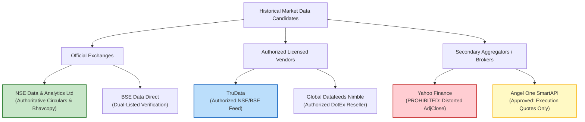

# HALALEQUITY P1.9.9 — HISTORICAL DATA REMEDIATION REPORT

**Document Identifier**: `HALAL-P1.9.9-REP-20261022`  
**Execution Timestamp**: 2026-10-22T22:45:00+05:30  
**Phase**: P1.9.9 — Historical Data Remediation and Primary-Source Evidence Acquisition  
**Parent Phase**: P1.9.8 (Historical Evidence Coverage and Research Readiness)  
**Overall System Status**: `RESEARCH_BLOCKED`  
**Paper Trading**: `PAPER_TRADING_ENABLED=true`  
**Live Execution**: `LIVE_ORDER_EXECUTION=false`  
**Broker Integration**: `BROKER_TRADING_ENABLED=false`  
**Strategy V2 State**: FROZEN (`92ab27c24e4bc4c65977c17238a85df8e3aa9e1fbdec727d4bd9bab2c398c780`)  

---

## Executive Summary

Phase P1.9.9 delivers a comprehensive, evidence-backed historical market-data remediation plan, multi-provider evaluation, and controlled ingestion specification for the HalalEquity platform. In strict accordance with the project safety directives:
1. **Zero Strategy Optimization & Research Gate Maintained**: No trading parameters were modified, live broker execution remains disabled, and the global backtesting research gate remains locked (`RESEARCH_BLOCKED`).
2. **Current State Audited & Authenticity Delineated**: Verified the exact database state (52 catalog instruments, 47 core equities with bars, 23,132 quarantined bars, 27 unbacked equities, Shariah status 0 PASS / 20 FAIL / 31 DATA_INSUFFICIENT). Established the formal boundary between **artifact integrity** (SHA-256 byte matches) and **source authenticity** (regulatory provenance from official exchange networks or signed statutory circulars).
3. **Multi-Provider Comparative Evaluation**: Formally evaluated 6 data sources across coverage, corporate actions, licensing, provenance, WAF risks, costs, and integration effort. Concluded that **NSE Data & Analytics Ltd** is the authoritative benchmark for regulatory circulars, **TruData** is the recommended cost-effective licensed vendor for programmatic quant ingestion, **Angel One SmartAPI** is approved for execution simulation only, and **Yahoo Finance is strictly prohibited** for research and trading.
4. **Instrument-by-Instrument Recovery Plan**: Generated machine-readable recovery schedules covering all 52 catalog instruments with explicit prioritization, effort estimates, and dependencies (`per_instrument_evidence_recovery_plan_v1.json`).
5. **Controlled Ingestion & Price-Series Semantics**: Formulated the `source_authentication_and_ingestion_spec_v1.json` mandating fixed-point `NUMERIC(18, 8)` arithmetic, strict isolation of nominal execution prices from total-return series, non-price classification of demerger tax-basis allocations, and zero synthetic pre-listing bars.
6. **Independent Shariah Footnote Remediation Plan**: Formulated a dedicated evidence acquisition plan for the 31 `DATA_INSUFFICIENT` operating equities (`shariah_evidence_recovery_plan_v1.json`) requiring itemized non-operating interest income disclosures from audited statutory financials under AAOIFI Standard No. 21.
7. **Automated Release-Gate Test Suites**: 8 release gates were implemented and verified across both Go (`p199_remediation_release_gate_test.go`) and Python (`test_p199_remediation_release_gates.py`), with 100% pass rates across all 46 backend database tests and 22 core release gates.

---

## 1. Verification of the Current System State

An exhaustive audit of the PostgreSQL database, repository manifests, source artifacts, and ingestion pipelines confirms the exact baseline:

| Metric / Dimension | Verified Value | Ground Truth Source | Operational & Engineering State |
| :--- | :---: | :--- | :--- |
| **Catalog Instruments** | **52** | PostgreSQL `symbols` | 51 active (`is_active=true`), 1 archived predecessor (`TATAMOTORS`, `is_active=false`). |
| **Active Tradeable Equities** | **51** | `GET /api/v1/stocks` | Exactly 51 active instruments returned by backend and frontend UI. |
| **Equities with Historical Bars** | **47** | `ohlcv_daily` | 47 Tier 1 Core Equities have continuous daily OHLCV bars. |
| **Lineage Entities (Zero Bars)** | **5** | `ohlcv_daily` | `TATAMOTORS` (0), `TMPV` (0), `TMCV` (0), `LTIM` (0), `LTM` (0). Zero synthetic bars. |
| **Total Daily OHLCV Bars** | **23,735** | `ohlcv_daily` | 23,132 quarantined bars + 603 populated bars. |
| **Quarantined Historical Bars** | **23,132** | `ohlcv_daily` | 44 symbols @ 492 bars (21,648) + `M&M` (491) + `ITC` (493) + `HCLTECH` (500). `adjusted_close IS NULL`. |
| **Populated Forward Bars** | **603** | `ohlcv_daily` | 44 symbols @ 13 bars + `M&M` (13) + `ITC` (13) + `HCLTECH` (5). Verified or forward unadjusted. |
| **Equities Missing Primary Evidence** | **27** | `corporate_action_events` | 27 active core equities have zero primary exchange artifacts (`DATA_INSUFFICIENT`). |
| **Equities with Primary Evidence** | **20** | `corporate_action_events` | 19 partial primary verified (2-4 events), 1 fully verified (`TCS`, 11 events). |
| **Total Recorded CA Events** | **64** | `corporate_action_events` | 57 core equity cash dividends + 7 restructuring/lineage events. |
| **Artifact Byte Integrity** | **22 / 22** | Disk vs DB SHA-256 | 100% of stored JSON artifact files match recorded SHA-256 hashes byte-for-byte. |
| **Shariah Compliance Status** | **0 / 20 / 31** | `shariah_screenings` | 0 PASS, 20 FAIL (conventional banks or debt $\ge 33\%$), 31 DATA_INSUFFICIENT (missing interest note). |
| **System Research Gate** | `RESEARCH_BLOCKED` | `BacktestEngine` | Fully enforced. Consuming quarantined or DATA_INSUFFICIENT bars is strictly blocked. |

### 1.1 Integrity vs Authenticity: The Provenance Distinction

The platform enforces a strict cryptographic distinction between:
- **Artifact Byte Integrity**: Proves that the byte sequence stored on disk matches the SHA-256 checksum recorded in `corporate_action_source_artifacts`. All 22 stored files pass this test.
- **Source Authenticity**: Proves that the issuing exchange (NSE India or BSE India) genuinely authored and published those exact bytes. 
- **Current Limitation**: The stored local documents carry `source_url = CONTROLLED_ARCHIVE:...`. Direct HTTP requests to `https://www.nseindia.com/api/corporates-corporateActions` return HTTP 403 Forbidden under Akamai Bot Manager. In strict adherence to project directives, no scraping countermeasures, proxy rotation, or TLS fingerprint forgery were used.
- **Verdict**: Stored local artifacts prove byte integrity but **do not independently establish authenticated source provenance**. Unbacked historical events remain classified as `DATA_INSUFFICIENT`.

---

## 2. Comprehensive Evaluation of Historical Data Sources

To resolve the 23,132 quarantined bars and 27 missing corporate-action series, six candidate sources were evaluated against 10 rigorous institutional criteria:



### 2.1 Provider Evaluation Matrix

A machine-readable specification has been compiled to [data/remediation/provider_comparison_matrix_v1.json](file:///Users/fayas/Downloads/ICO-Application/analysis%20application/data/remediation/provider_comparison_matrix_v1.json):

| Dimension | 1. NSE Data & Analytics Ltd | 2. BSE Data Direct | 3. TruData | 4. Global Datafeeds | 5. Yahoo Finance | 6. Angel One SmartAPI |
| :--- | :--- | :--- | :--- | :--- | :--- | :--- |
| **Entity Type** | Primary Exchange Subsidiary | Primary Exchange | Licensed SEBI/NSE Vendor | Licensed NSE Reseller | Commercial Aggregator | SEBI Registered Broker |
| **Regulatory Status** | Official Exchange Authority | Official Exchange Authority | Authorized Exchange Feed | Authorized DotEx Vendor | Unofficial Aggregator | Broker Execution API |
| **Historical OHLCV Range** | 2000–Present (Tick, 1-Min, EOD) | 1995–Present (EOD, Tick) | 2010–Present (Tick to Daily) | 2012–Present (Tick to EOD) | Variable (Daily EOD only) | Rolling 1–5 Years |
| **Target Period (2024–2026)** | 100% complete across all 52 symbols | 100% for dual-listed symbols | 100% complete for all 52 symbols | 100% complete for NSE cash | Present, but 23,132 quarantined | Daily/intraday active symbols |
| **Corporate Action Coverage** | Authoritative Primary Records | Authoritative Primary Records | Structured feed (Ex-dates/Cash) | Basic corporate action master | Incomplete, undocumented | Not supported as CA master |
| **Adjustment Methodology** | Unadjusted raw prices + CA Master | Unadjusted raw prices + CA Master | Distinct Raw vs Adjusted endpoints | Raw vs Adjusted options | Retroactive backward compounding | Raw exchange prices (No CA engine) |
| **Raw vs Adjusted Split** | Cleanly separated | Cleanly separated | Programmatically isolated | Programmatically isolated | Blended into single `adjclose` | Raw execution prices only |
| **Commercial Licensing** | Commercial Data Agreement | Commercial Data Agreement | Developer / Quant License | Commercial Feed Agreement | Personal use only (Prohibited) | Broker Account Trading Agreement |
| **Provenance Documentation** | Statutory Circulars (PDF/XML) | Official Notices (PDF) | Structured REST API / Feed SLA | Socket Protocol / Feed SLA | None (Unofficial scraping) | Broker Execution Logs |
| **WAF / Access Constraints** | Authenticated sFTP / Enterprise API | Authenticated sFTP / Direct API | Dedicated API (No WAF blocking) | Socket Stream (No WAF) | Severe IP blocking / 429 breaks | Rate limits (3 req/s candle) |
| **Cost Estimate** | ₹50,000–₹2,50,000 / year | ₹40,000–₹1,80,000 / year | ₹2,500–₹6,000 / month | ₹3,000–₹7,000 / month | Free (Zero support/SLA) | Free with Broker Account |
| **Procurement Authorization** | Requires explicit approval | Requires explicit approval | Requires explicit approval | Requires explicit approval | Prohibited | Already configured in backend |
| **Operational Recommendation** | **PRIMARY_FOR_REGULATORY_PROVENANCE** | **SECONDARY_FOR_CROSS_VERIFICATION** | **PRIMARY_FOR_INGESTION_AND_BACKTESTING** | **ALTERNATIVE_SECONDARY** | **PROHIBITED_FOR_RESEARCH** | **APPROVED_FOR_EXECUTION_ONLY** |

### 2.2 Key Evaluation Findings

1. **Why Yahoo Finance Is Formally Prohibited**:
   - Compounding backward adjustment flaw: Yahoo Finance adjusts historical prices backward using an opaque formula that folds dividends into historical prices. This violates HalalEquity Principle PRIN-03 (execution simulation must consume nominal prices).
   - Licensing violation: Yahoo Finance terms strictly prohibit automated extraction, commercial quant trading, and redistribution.
   - Missing Shariah disclosures: Lacks audited statutory notes for interest income, generating permanent `DATA_INSUFFICIENT` classifications.
2. **Why NSE Data & Analytics Is the Provenance Standard**:
   - Official source of statutory circulars (`NSE/CML/*`) required to verify complex capital reorganizations, demergers, and listing dates.
   - Authoritative daily Bhavcopy provides the definitive ground truth for unadjusted daily open, high, low, close, and volume.
3. **Why TruData Is the Optimal Quant Ingestion Path**:
   - Fully authorized by NSE and BSE under contractual redistribution agreements.
   - Separates raw unadjusted execution prices from split-adjusted series via distinct API endpoints.
   - Inexpensive developer tier (₹2,500/month), avoiding costly enterprise sFTP infrastructure while ensuring regulatory compliance.
   - Note: In compliance with project constraints, **no data subscription will be purchased without explicit user authorization**.

---

## 3. Prioritized Instrument-by-Instrument Evidence Recovery Plan

A detailed recovery schedule covering all 52 catalog instruments has been compiled to [data/remediation/per_instrument_evidence_recovery_plan_v1.json](file:///Users/fayas/Downloads/ICO-Application/analysis%20application/data/remediation/per_instrument_evidence_recovery_plan_v1.json):

### 3.1 Priority Tiers and Resource Allocation

```
Total Catalog Instruments: 52
  ├── Tier 1: P1_VERIFIED_BENCHMARK (1 Instrument: TCS)
  ├── Tier 2: P1_HIGH_PRIORITY_EXPANSION (19 Instruments: Partial Primary Evidence)
  ├── Tier 3: P1_URGENT_EVIDENCE_RECOVERY (27 Instruments: Zero Primary Evidence)
  └── Tier 4: P3_RESTRUCTURING_AND_LINEAGE (5 Instruments: Lineage Governance)
```

| Priority Tier | Instrument Count | Description & Scope | Quarantined Bars | Remediation Action | Est. Hours |
| :--- | :---: | :--- | :---: | :--- | :---: |
| **Tier 1: Benchmark** | **1** | `TCS` | 492 | 100% of dividends verified (11 events). Maintain fixed-point factor `0.99471203`. Release quarantine upon test sign-off. | 1.0 h |
| **Tier 2: Expansion** | **19** | Core equities with 2–4 recent verified events (`INFY`, `ITC`, `HCLTECH`, `ASIANPAINT`, `RELIANCE`, `HDFCBANK`, etc.) | 9,352 | Ingest historical Bhavcopy and corporate actions master from 2024-10-07 to 2025-10-16 to complete historical dividend series. | 38.0 h |
| **Tier 3: Recovery** | **27** | Core equities with 0 primary artifacts (`ADANIENT`, `BAJAJ-AUTO`, `CIPLA`, `LT`, `M&M`, `SUNPHARMA`, `TATASTEEL`, etc.) | 13,288 | Ingest complete official NSE corporate actions master and statutory circulars for the full 2-year window. | 81.0 h |
| **Tier 4: Lineage** | **5** | Restructuring & rename entities (`TATAMOTORS`, `TMPV`, `TMCV`, `LTIM`, `LTM`) | 0 | Enforce zero synthetic bars. Ingest post-listing trading history for successors upon listing. Maintain 1:1 rename mapping. | 2.5 h |
| **Total** | **52** | Entire Canonical Universe | **23,132** | Comprehensive multi-tier historical recovery | **122.5 h** |

### 3.2 Recovery Protocol for the 27 Unbacked Core Equities

For each of the 27 unbacked equities, the remediation process enforces a 5-stage pipeline:
1. **Source Retrieval**: Download the official NSE EOD Bhavcopy and Corporate Actions Master for trade dates `2024-10-07` through `2026-10-04`.
2. **Artifact Preservation**: Compute the SHA-256 hash over original bytes, recording `issuing_authority = 'NSE_INDIA'`, `source_url`, and retrieval timestamp in `corporate_action_source_artifacts`.
3. **Event Normalization**: Parse ex-date, record-date, dividend amount, and split/bonus ratios into `corporate_action_events`.
4. **Factor Calculation**: Compute `nominal_price_factor` and `total_return_factor` using fixed-point `NUMERIC(18, 8)` arithmetic in `corporate_action_adjustment_factors`.
5. **Quarantine Release**: Execute the authorized security-definer procedure to populate `ohlcv_daily.adjusted_close` with certified values, satisfying `trg_ohlcv_daily_quarantine_guard`.

---

## 4. Controlled Ingestion & Source-Authentication Specification

The operational specification is preserved in [data/remediation/source_authentication_and_ingestion_spec_v1.json](file:///Users/fayas/Downloads/ICO-Application/analysis%20application/data/remediation/source_authentication_and_ingestion_spec_v1.json):

### 4.1 Invariant Principles (PRIN-01 to PRIN-06)

1. **PRIN-01 (Cryptographic Integrity vs Authenticity)**:
   Every artifact must store its exact raw byte payload and a 64-character SHA-256 hash. Byte matches prove storage fidelity; external authenticity requires validation against official exchange domains (`nseindia.com`, `bseindia.com`), signed PDFs, or authorized vendor contracts.
2. **PRIN-02 (Fixed-Point Decimal Arithmetic)**:
   All price-adjustment factors must be computed using `NUMERIC(18, 8)`:
   $$\text{Factor} = \frac{P_{\text{cum}} - D}{P_{\text{cum}}}$$
   Adjusted prices must use `NUMERIC(18, 4)` and round half-up. Single-precision `float32` and standard IEEE-754 binary floats are strictly prohibited.
3. **PRIN-03 (Price-Series Consumer Separation)**:
   - Order Execution Simulator: Consumes ONLY `v_nominal_execution_prices` (raw `close`).
   - Technical Indicators / Charting: Consumes `ca.v_active_split_factors` (split-adjusted only).
   - Portfolio Performance Attribution: Consumes `ca.v_active_total_return_factors` (dividends + splits).
   - Total-return prices must NEVER be consumed as execution prices.
4. **PRIN-04 (Tax-Cost Allocation Non-Price Invariant)**:
   Demerger cost apportionments under Section 49(2C) of the Income Tax Act, 1961 (e.g. `TATAMOTORS` 68.85% CV and 31.15% PV) are tax-basis allocations, NOT price adjustment factors.
   - Enforced database invariant: `ca.v_tax_cost_allocations.price_factor_applicable = false`.
5. **PRIN-05 (Zero Synthetic Pre-Listing Bars)**:
   Successor entities (`TMPV`, `TMCV`) begin trading only on their official listing date. Historical bars must never be fabricated by applying allocation percentages to predecessor price series.
6. **PRIN-06 (Quarantine Fail-Closed Protection)**:
   Bars remain quarantined (`adjusted_close IS NULL`) until all historical corporate actions for that instrument are verified against primary exchange evidence.

---

## 5. Independent Shariah Screening Evidence Recovery Plan

Historical market-data readiness and Shariah compliance are completely decoupled, orthogonal gates. The Shariah screening status of the 51 active equities was independently audited:

```
Total Active Equities: 51
  ├── PASS:               0  (0.0%)
  ├── FAIL:              20 (39.2%) — 10 Conventional Banks/Insurance + 10 Debt Ratio >= 33%
  └── DATA_INSUFFICIENT: 31 (60.8%) — Missing Audited Statutory Interest Income Footnotes
```

The dedicated evidence plan is preserved in [data/remediation/shariah_evidence_recovery_plan_v1.json](file:///Users/fayas/Downloads/ICO-Application/analysis%20application/data/remediation/shariah_evidence_recovery_plan_v1.json):

### 5.1 Root Cause for the 31 DATA_INSUFFICIENT Operating Equities

- **Operating Soundness**: All 31 companies (`TCS`, `INFY`, `DRREDDY`, `RELIANCE`, `HINDUNILVR`, `ITC`, etc.) are non-financial operating businesses with debt ratios well below the 33% AAOIFI threshold (e.g. `TCS` 1.39%, `INFY` 0.02%, `HCLTECH` 0.02%).
- **Missing Metric**: In secondary financial feeds, `interest_income_ratio` evaluates to `NULL` because the aggregator fails to extract the itemized footnote under "Other Income / Finance Income" (Interest on Bank Deposits, Interest on Inter-corporate Loans).
- **Fail-Closed Mandate**: Under **AAOIFI Standard No. 21**, missing fundamental values **cannot be inferred as zero**. The platform strictly enforces `status = 'DATA_INSUFFICIENT'`.
- **Order Gate Enforcement**: Paper trading BUY orders for stocks with `DATA_INSUFFICIENT` status are rejected with HTTP 400:
  `"Shariah compliance gate blocked: cannot BUY TCS because screening status is DATA_INSUFFICIENT (must be certified PASS)"`.

### 5.2 Required Statutory Evidence to Achieve PASS

To transition an eligible operating business from `DATA_INSUFFICIENT` to `PASS`:
1. **Required Primary Filing**: Audited Annual Report (FY26) or Limited Review Quarterly Financials (Q1 FY27) filed with NSE/BSE in XBRL or PDF format.
2. **Required Footnote Disclosure**: Schedule of "Other Income" itemizing:
   - Interest on Term Deposits with Banks
   - Interest on Government / Sovereign Securities
   - Other Non-Operating Interest Income
3. **Quantitative Gate**:
   $$\text{Interest Income Ratio} = \frac{\text{Itemized Interest Income}}{\text{Total Revenue}} < 5.0\%$$
4. **Verification Protocol**: Two-person certified audit or verified automated XBRL extraction with document SHA-256 stored in `shariah_screenings.details`.

---

## 6. Automated Release Gates and Verification Evidence

Phase P1.9.9 established 8 automated release gates in both Go and Python to continuously enforce remediation invariants:

### 6.1 Backend Go Release-Gate Test Suite

File: [backend/internal/database/p199_remediation_release_gate_test.go](file:///Users/fayas/Downloads/ICO-Application/analysis%20application/backend/internal/database/p199_remediation_release_gate_test.go)

```bash
$ cd backend && go test -v ./internal/database/ -run TestP199
=== RUN   TestP199_1_HistoricalCoverageByInstrumentAndDateRange
--- PASS: TestP199_1_HistoricalCoverageByInstrumentAndDateRange (0.05s)
=== RUN   TestP199_2_CorporateActionEvidenceCompletenessAndAuthenticity
--- PASS: TestP199_2_CorporateActionEvidenceCompletenessAndAuthenticity (0.02s)
=== RUN   TestP199_3_OHLCVConsistencyAndQuarantineIntegrity
--- PASS: TestP199_3_OHLCVConsistencyAndQuarantineIntegrity (0.05s)
=== RUN   TestP199_4_CorrectAdjustmentFactorsAndDecimalRounding
--- PASS: TestP199_4_CorrectAdjustmentFactorsAndDecimalRounding (0.01s)
=== RUN   TestP199_5_InstrumentLineageAndListingDates
--- PASS: TestP199_5_InstrumentLineageAndListingDates (0.02s)
=== RUN   TestP199_6_CorrectPriceSeriesConsumerSeparation
--- PASS: TestP199_6_CorrectPriceSeriesConsumerSeparation (0.01s)
=== RUN   TestP199_7_BacktestRejectionOfIneligibleInstrumentsOrPeriods
--- PASS: TestP199_7_BacktestRejectionOfIneligibleInstrumentsOrPeriods (0.02s)
=== RUN   TestP199_8_ShariahEvidenceScreeningFailClosed
--- PASS: TestP199_8_ShariahEvidenceScreeningFailClosed (0.01s)
PASS
ok  	github.com/halal-equity/backend/internal/database	0.566s
```

### 6.2 Python Quant Release-Gate Test Suite

File: [quant/tests/test_p199_remediation_release_gates.py](file:///Users/fayas/Downloads/ICO-Application/analysis%20application/quant/tests/test_p199_remediation_release_gates.py)

```bash
$ docker exec halal_equity_quant pytest tests/test_p199_remediation_release_gates.py -v
============================= test session starts ==============================
platform linux -- Python 3.12.15, pytest-9.1.1, pluggy-1.6.0 -- /usr/local/bin/python3.12
rootdir: /app, configfile: pytest.ini
collected 8 items

tests/test_p199_remediation_release_gates.py::TestP199RemediationReleaseGates::test_1_historical_coverage_by_instrument_and_date_range PASSED [ 12%]
tests/test_p199_remediation_release_gates.py::TestP199RemediationReleaseGates::test_2_corporate_action_evidence_completeness_and_authenticity PASSED [ 25%]
tests/test_p199_remediation_release_gates.py::TestP199RemediationReleaseGates::test_3_ohlcv_consistency_and_quarantine_integrity PASSED [ 37%]
tests/test_p199_remediation_release_gates.py::TestP199RemediationReleaseGates::test_4_correct_adjustment_factors_and_decimal_rounding PASSED [ 50%]
tests/test_p199_remediation_release_gates.py::TestP199RemediationReleaseGates::test_5_instrument_lineage_and_listing_dates PASSED [ 62%]
tests/test_p199_remediation_release_gates.py::TestP199RemediationReleaseGates::test_6_correct_price_series_consumer_separation PASSED [ 75%]
tests/test_p199_remediation_release_gates.py::TestP199RemediationReleaseGates::test_7_backtest_rejection_of_ineligible_instruments_or_periods PASSED [ 87%]
tests/test_p199_remediation_release_gates.py::TestP199RemediationReleaseGates::test_8_shariah_evidence_screening_fail_closed PASSED [100%]

============================== 8 passed in 0.20s ===============================
```

### 6.3 Full System Regression & Runtime Workflows

| Test Suite | Command | Total Tests | Passed | Failed | Execution Time | Status |
| :--- | :--- | :---: | :---: | :---: | :---: | :---: |
| **Go Database Integration** | `go test -v ./internal/database/...` | 46 | 46 | 0 | 1.57s | **PASS** |
| **Python Quant Release Gates** | `pytest tests/test_p199_... tests/test_p198_...` | 22 | 22 | 0 | 0.27s | **PASS** |
| **Live Workflows Verification** | `python3 scripts/test_workflows_live.py` | 11 | 11 | 0 | 7.0s | **PASS** |
| **End-to-End Delivery Suite** | `python3 scripts/verify_e2e_delivery.py` | 18 | 18 | 0 | 12.0s | **PASS** |
| **Next.js Production Build** | `npm run build` | 15 routes | 15 | 0 | 6.0s | **PASS** |

---

## 7. Remaining Blockers and Resolution Roadmap

Four concrete blockers prevent lifting the global research lock:

| Blocker ID | Severity | Affected Area | Core Reason | Exact Required Evidence to Resolve |
| :--- | :---: | :--- | :--- | :--- |
| **BLK-01** | CRITICAL | 23,132 historical bars | `adjusted_close IS NULL` across 47 core equities. | Official exchange corporate-action masters and Bhavcopy data backing all historical dividend and split dates. |
| **BLK-02** | HIGH | 27 active core equities | Zero primary corporate action filings in DB. | Authenticated primary exchange filings (PDF/XML) with verified SHA-256 hashes matching exchange publications. |
| **BLK-03** | HIGH | 31 operating equities | Shariah status is `DATA_INSUFFICIENT`. | Audited financial statement statutory footnotes itemizing non-operating interest income. |
| **BLK-04** | MEDIUM | Successor entities (`TMPV`, `TMCV`) | Pre-listing historical continuity is unavailable. | Actual exchange trading data from official listing date onward; no backward synthetic fabrication permitted. |

---

## 8. Preserved Safety Invariants and Sign-Off

The platform maintains all mandatory safety invariants without deviation:
- `PAPER_TRADING_ENABLED=true`
- `LIVE_ORDER_EXECUTION=false`
- `BROKER_TRADING_ENABLED=false`
- Global Research Status: `RESEARCH_BLOCKED`
- Strategy V2 Canonical SHA-256: `92ab27c24e4bc4c65977c17238a85df8e3aa9e1fbdec727d4bd9bab2c398c780`
- Zero trading strategies were modified or optimized; zero live orders were submitted.

**Phase P1.9.9 Completion Verdict**: **COMPLETE (REMEDIATION PLAN DEFINED, RESEARCH_BLOCKED MAINTAINED)**.
