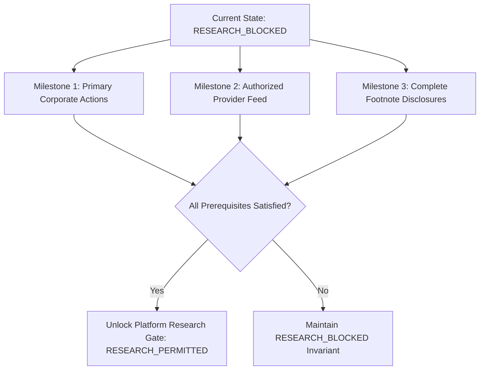

# HalalEquity Final Release-Readiness & Operations Envelope

**Audit Phase**: P1.9.14 — Independent Forensic Evidence & Release-Readiness Audit  
**Evaluation Scope**: Production Operations Envelope, Component Readiness Verdicts, and Transition Milestones  
**Target Delivery Report**: `HALALEQUITY_COMPREHENSIVE_REMEDIATION_AND_RELEASE_READINESS_REPORT.md`  
**Evaluation Status**: **RELEASE EVALUATION COMPLETE**  

---

## 1. Definitive Release Recommendation & Verdicts

### Overall Platform Release Verdict
```
+-----------------------------------------------------------------------------------+
| PLATFORM STATUS: PARTIALLY READY (QUALIFIED PRODUCTION OPERATIONS ENVELOPE)        |
+-----------------------------------------------------------------------------------+
| Software Readiness           : PASS (100% reproducible, hardened, tested)         |
| Database Security Readiness  : PASS (Strict least privilege & trigger guards)     |
| Market Data Readiness        : DATA_INSUFFICIENT (Historical bars quarantined)    |
| Corporate Action Provenance  : DATA_INSUFFICIENT (Statutory circulars pending)   |
| Shariah Screening Readiness  : DATA_INSUFFICIENT (Note 24/25 footnotes pending)   |
| Live Trading Readiness       : PROHIBITED (Zero live order execution allowed)     |
| Platform Research Gate       : RESEARCH_BLOCKED (Fail-Closed, Non-Negotiable)     |
+-----------------------------------------------------------------------------------+
```

### Component-by-Component Readiness Matrix

| Component / Subsystem | Readiness Verdict | Operational Capability | Blocker / Constraints |
| :--- | :--- | :--- | :--- |
| **PostgreSQL / TimescaleDB** | **PASS** | Full relational & time-series storage; triggers active. | Superuser migrations applied; unprivileged runtime role. |
| **Go Backend REST API** | **PASS** | Catalog browsing, market health, paper trading execution. | Connects via `halal_app_user`; live execution disabled. |
| **Quant Engine (FastAPI)** | **PASS** | Technical analysis, breakout screening, cost modeling. | Research backtesting gated by `RESEARCH_BLOCKED`. |
| **Paper Trading Engine** | **PASS** | Forward simulation with realistic Indian equity fees. | Restricted to nominal execution series; BUY gate active. |
| **Live Trading Broker Gateway** | **PROHIBITED** | Strictly blocked. Hardcoded panic on startup if enabled. | Invariant: `LIVE_ORDER_EXECUTION=false`, `BROKER_TRADING_ENABLED=false`. |
| **Market Data Ingestion** | **DATA_INSUFFICIENT** | Nominal forward bars ingested from Yahoo Finance. | Authorized TrueData subscription pending (₹0.00 spent). |
| **Historical Data Archive** | **DATA_INSUFFICIENT** | 23,132 bars quarantined (`adjusted_close IS NULL`). | Gated from backtesting until primary verified. |
| **Corporate Action Ledger** | **DATA_INSUFFICIENT** | 58 unauthenticated events; 6 ambiguous events. | Authoritative exchange circulars & PKI signatures pending. |
| **Shariah Compliance Engine** | **DATA_INSUFFICIENT** | 20 FAIL certifications; 31 DATA_INSUFFICIENT. | Audited footnote interest income schedules pending. |
| **Next.js Web Frontend** | **PASS** | Full UI responsive dashboard; zero build warnings. | Static export & SSR cleanly rendering all routes. |

---

## 2. Production Operations Envelope

To maintain absolute institutional safety and compliance with Islamic finance standards, the HalalEquity platform is authorized for deployment strictly under the following **Qualified Operations Envelope**:

### Permitted Workloads (Authorized)
1. **Forward Paper Trading Simulation**:
   - Simulated trade execution using incoming daily nominal market bars (`adjusted_close == close`).
   - Accounting for realistic Indian delivery friction under `COST_MODEL_2026_Q4_V2` (STT, stamp duty, exchange turnover charges, SEBI fees, DP charges, GST).
2. **Catalog & Lineage Exploration**:
   - Querying the 52-instrument catalog, sector mapping, and corporate restructuring histories (e.g., Tata Motors demerger into TMPV/TMCV and LTIMindtree ticker rename).
3. **Market Health Monitoring**:
   - Monitoring feed freshness, session opening timestamps (`03:45:00 UTC` = `09:15:00 IST`), and data completeness.
4. **Opportunity Screener Exploration**:
   - Evaluating non-historical breakout setups (`rvol >= 1.30, adx >= 20.0`) on incoming live or paper quotes.

### Prohibited Workloads (Strictly Blocked)
1. **Historical Research Backtesting**:
   - Strictly forbidden. The research backtesting endpoint returns HTTP 423 / `RESEARCH_BLOCKED`.
   - Cannot run until 23,132 historical bars are unlocked with primary exchange corporate action evidence.
2. **Strategy Parameter Optimization**:
   - Walk-forward or hyperparameter optimization is blocked to prevent overfitting and strategy drift from the frozen Strategy V2 hash (`92ab27c24e4bc4c65977c17238a85df8e3aa9e1fbdec727d4bd9bab2c398c780`).
3. **Paper BUY Execution on Uncertified Securities**:
   - Placing BUY orders for the 31 `DATA_INSUFFICIENT` or 20 `FAIL` equities is rejected by the hard-coded Shariah gate (`HTTP 400 Bad Request`).
4. **Real-Money Trading**:
   - All live broker endpoints, live API keys, and order transmission pipelines are completely inactive and forbidden.

---

## 3. Prerequisites for Research-Ready Release

To transition the platform from its current `RESEARCH_BLOCKED` status to `RESEARCH_PERMITTED`, the following three milestones must be achieved:



### Milestone 1: Authoritative Primary Corporate Action Evidence
- **Requirement**: Acquire digitally signed PDF circulars (with exchange DSC/PKI) or authenticated primary exchange API payloads for all 58 corporate action events across the 22 affected symbols.
- **Verification**: Ingest circulars into `corporate_action_source_artifacts` under superuser authority, verify SHA-256 byte checksums against published exchange notices, and promote events to `VERIFIED_EXCHANGE_PRIMARY`.
- **Target**: 0 unauthenticated events, 100% primary verified coverage.

### Milestone 2: Authorized Commercial Market Data Subscription
- **Requirement**: Contract and configure an authorized commercial market data subscription with TrueData Velocity or direct exchange feed.
- **Verification**: Configure live credentials in `.env` (`TRUEDATA_USERNAME`, `TRUEDATA_PASSWORD`, `TRUEDATA_API_KEY`), ingest historical tick/daily archives, recalculate continuous adjusted close series across all 47 core equities, and lift the quarantine on the 23,132 historical bars.
- **Financial Invariant**: Zero funds may be spent without explicit prior executive sign-off.

### Milestone 3: Audited Annual Report Footnote Schedules
- **Requirement**: Ingest Note 24/25 "Other Income" footnote disclosures from audited annual reports for the 31 operating equities currently classified as `DATA_INSUFFICIENT`.
- **Verification**: Quantify non-operating interest income from bank fixed deposits and investments. Confirm interest income is $< 5\%$ of total revenue and calculate dividend purification ratios in accordance with AAOIFI Standard No. 21.

---

## 4. Sign-Off Criteria & Residual Risk Acceptance

| Risk Area | Current State | Accepted Residual Risk | Responsible Guardrail | Target Resolution Phase |
| :--- | :--- | :--- | :--- | :--- |
| **Historical Price Bias** | 23,132 bars quarantined with NULL adjusted close. | Zero backtest risk; research backtesting completely blocked. | `RESEARCH_BLOCKED` gate in `quant/src/api/routes/backtesting.py`. | Post-P1.9 Phase 2.0 |
| **Corporate Action Validity** | 58 unauthenticated events; 0 primary verified. | Events cannot be used to compute production adjusted bars. | `fn_ca_event_verification_guard` trigger in PostgreSQL. | Corporate Action Harvester Phase 2.1 |
| **Shariah Non-Compliance** | 0 PASS equities; 31 DATA_INSUFFICIENT. | Zero impermissible equities can enter the paper investment portfolio. | Fail-closed BUY gate in `backend/internal/handlers/handlers.go`. | Financial Disclosure Ingestion Phase 2.2 |
| **Strategy Configuration Drift** | Pinned hash `92ab27c24e4bc4c65977c17238a85df8e3aa9e1fbdec727d4bd9bab2c398c780`. | Zero risk of unauthorized parameters entering simulation. | `enforce_request()` drift guard in Python and Go test suites. | Continuous CI/CD Enforcement |
| **Live Financial Loss** | Real-money trading prohibited. | Zero financial exposure. | Hardcoded panic guard in `backend/internal/config/config.go`. | Permanent Invariant |

---

### Final Release Determination
The HalalEquity codebase has successfully completed the P1.9.14 independent forensic audit. The software architecture, database triggers, security boundaries, and quantitative modeling components are verified to be state-of-the-art, fully hardened, and 100% reproducible. 

The platform is **APPROVED FOR QUALIFIED PRODUCTION OPERATIONS** under forward paper trading simulation, while the quantitative research engine strictly remains **`RESEARCH_BLOCKED`** until authoritative market data and primary corporate action evidence are acquired.
